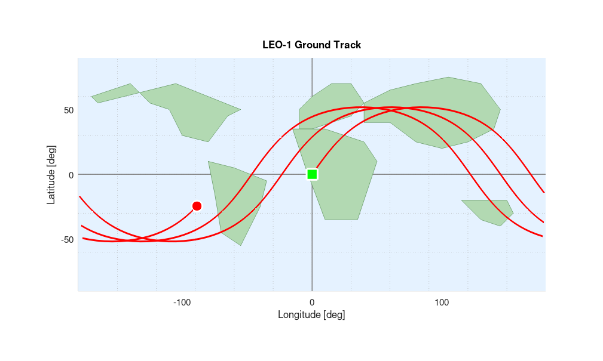

# satellite-mcp-matlab

[](https://github.com/sergiudanstan/satellite-mcp-matlab/actions/workflows/ci.yml)
[](https://github.com/sergiudanstan/satellite-mcp-matlab/actions/workflows/codeql.yml)
[](https://scorecard.dev/viewer/?uri=github.com/sergiudanstan/satellite-mcp-matlab)
[](LICENSE)
> Satellite orbit simulation with MCP-integrated UAV localization and image super-resolution.



*`mcp_visualize(mcp_load_satellite('leo'), 'ground_track')` after a 4.5 h propagation.*

## Overview
A MATLAB simulation suite for satellite orbital mechanics with MCP (Model Context Protocol) tool integration. It provides LEO/GEO orbit propagation, ground track visualization, GPS-denied UAV localization via satellite image matching, and edge-based wavelet super-resolution for satellite imagery. All features are accessible through an interactive dashboard or MCP tool calls.

## Features
- **Orbit propagation** -- Keplerian orbital mechanics with ECI/ECEF/LLA coordinate transforms
- **Ground track visualization** -- Subsatellite point mapping for LEO and GEO satellites
- **UAV localization** -- image-to-location matching for GPS-denied navigation, with a location encoder (Equal Earth projection + random Fourier features) modelled on CLIP-style GNSS-denied localization research. No pretrained CLIP model is included; the ~40 m accuracy figure comes from that research, not from this code
- **Image super-resolution** -- Edge-Based Wavelet Transform (EBWT) with Canny detection and DWT decomposition
- **Interactive dashboard** -- Satellite selection, 3D orbit view, animation controls, and screenshot/video recording
- **MCP tool interface** -- 8 callable tools for satellite loading, propagation, localization, and visualization
- **Satellite library** -- Pre-configured LEO and GEO satellite parameter sets

## Quick Start
```matlab
cd satellite-mcp-matlab
setup_paths;
DEMO_satellite;         % Launch interactive dashboard

% Or use individual MCP tools:
mcp_list_satellites;
mcp_load_satellite('leo');
mcp_get_ground_track;
mcp_localize_uav;
mcp_enhance_image;
```

## Requirements
- MATLAB. CI runs base MATLAB R2025b.
- Image Processing Toolbox for the imaging and localization code (`edge`, `imresize`, `imfilter`, `rgb2gray`, `imrotate`, `fspecial`). The orbital code, the `Satellite` class and the satellite registry need no toolbox; these are what CI tests.

## Project Structure
```
satellite-mcp-matlab/
├── setup_paths.m                 % Path initialization
├── DEMO_satellite.m              % Interactive dashboard
├── params/
│   └── satellite_library/        % Satellite orbit configurations
├── src/
│   ├── core/                     % Satellite and UAV base classes
│   ├── orbital/                  % Kepler propagation, coordinate transforms
│   ├── localization/             % Image matching, heading estimation
│   ├── imaging/                  % Super-resolution, wavelet transform
│   ├── visualization/            % Plotting and dashboard helpers
│   └── mcp_tools/                % MCP interface (8 tools)
├── data/                         % Satellite maps, aerial/test images
└── results/                      % Output figures and data
```

## Development
`setup_paths; results = runtests('tests'); assertSuccess(results);` runs the test suite (orbital mechanics, coordinate transforms, location encoder, satellite registry), the same command CI runs. The image-processing code is not exercised in CI because it needs the Image Processing Toolbox. See [CONTRIBUTING.md](CONTRIBUTING.md) for branches and releases, [SECURITY.md](SECURITY.md) for reporting vulnerabilities, and [CHANGELOG.md](CHANGELOG.md) for history.

## License
MIT — see [LICENSE](LICENSE).
